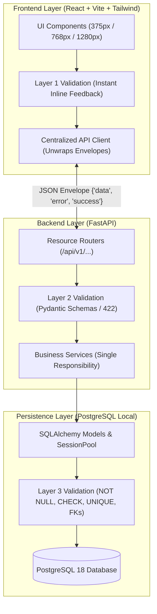

# Architecture & Technical Reasoning

This document outlines the architectural decisions, design patterns, and systemic reasoning behind the application. It strictly adheres to the **8-Level Architectural Questionnaire** (`notes/questionaire.md`) and the **Odoo Hackathon Evaluator Scoring Rubric**.

---

## 1. 30-Second Architecture Diagram (Level 8, Q29)



---

## 2. The 8-Level Architectural Framework

### Level 1: Project Understanding
- **Q1 (Problem):** Solves the chosen problem statement with a single, thoroughly implemented, high-reliability workflow.
- **Q2 (Target User):** Designed for real-world operational personas requiring high data integrity and intuitive, zero-training navigation.
- **Q3 (Constraints):** 8-hour time constraint, 100% offline local resilience (no external BaaS/cloud), responsive across mobile (375px), tablet (768px), and desktop (1280px).
- **Q4 (Measurable Success):**
  1. Zero unvalidated data leakage into the database (3-layer validation).
  2. Sub-50ms local API response times with zero N+1 queries.
  3. Seamless 3-click navigation flow with instant state reflection.

---

### Level 2: Architecture Decisions
- **Q5 (Modules & Domains):** Modular domain separation (e.g., `Core`, `Models`, `Schemas`, `Services`, `Routes`).
- **Q6 (Communication Contracts):** Strictly interface/API-driven. Frontend talks exclusively to REST endpoints; services never access cross-domain tables without explicit service interfaces.
- **Q7 (Data Ownership):** Each domain owns its database entities and tables; foreign keys establish explicit relational ownership.
- **Q8 (Dependencies):** Strictly unidirectional flow:
  $$\text{Frontend UI} \longrightarrow \text{REST Routers} \longrightarrow \text{Domain Services} \longrightarrow \text{SQLAlchemy Adapters} \longrightarrow \text{PostgreSQL}$$

---

### Level 3: Feature Implementation
- **Q9 (Happy Path):** User inputs data $\to$ client validation validates format $\to$ API parses Pydantic model $\to$ Service executes business rules $\to$ PostgreSQL commits transaction $\to$ standard envelope response $\to$ UI updates dynamically.
- **Q10 (Edge Cases & Failure Handling):**
  1. *Duplicate records:* Caught by DB UNIQUE constraint $\to$ transformed to friendly 409/400 message.
  2. *Malformed input:* Caught by Pydantic $\to$ 422 Unprocessable Entity with human-readable guidance.
  3. *Network / DB disconnect:* Handled gracefully by frontend API service with an offline error banner.
- **Q11 (Layer Allocation):**
  - **Domain:** Business rules and core constraints.
  - **UseCase / Service:** Transaction orchestration and business workflows.
  - **Adapter:** FastAPI routing, SQLAlchemy sessions, and PostgreSQL storage.
- **Q12 (Isolated Testing):** Services can be tested independently of HTTP routing or browser interactions.

---

### Level 4: Code Design
- **Q13 (Single Responsibility):** Each function performs exactly one job (e.g., `check_db_connection` only verifies ping; `validation_exception_handler` only formats error messages).
- **Q14 (Contracts):** Strict typing via Pydantic v2 schemas and Python type hints (`int`, `str`, `Optional[T]`).
- **Q15 (Framework Decoupling):** Business rules live in pure Python services, isolated from framework-specific dependencies.
- **Q16 (Independent Testability):** Database sessions are injected via FastAPI dependencies (`get_db`), enabling straightforward mocking.

---

### Level 5: Code Quality & Boundaries
- **Q17 (Purity & Predictability):** Validation and formatting functions are deterministic pure functions (same input $\to$ same output without side-effects).
- **Q18 (Boundary Integrity):** No direct cross-table monkeypatching; all persistence goes through designated SQLAlchemy models.
- **Q19 (Loose Coupling):** Modules interact through defined schema contracts; changing an internal route implementation doesn't break domain logic.
- **Q20 (2-Minute Rule):** Clean variable naming, self-documenting code, and comments explaining *why* (architectural reasoning) rather than *what*.

---

### Level 6: Database Design (Evaluator Priority #1)
- **Q21 (Normalization):** 3NF relational design; zero redundant or duplicated data across tables.
- **Q22 (Foreign Keys & Integrity):** Strict referential integrity enforced with appropriate `ON DELETE CASCADE` or `RESTRICT` policies.
- **Q23 (Indexes):** Primary keys indexed by default; B-tree indexes added on foreign keys, frequently filtered status fields, and sorted columns.
- **Q24 (N+1 Query Elimination):** Use of SQLAlchemy `joinedload` / `selectinload` and batch queries to guarantee single-query data retrieval.

---

### Level 7: API Design
- **Q25 (Resource-Oriented REST):** Nouns instead of verbs (e.g. `GET /api/items`, `POST /api/items`).
- **Q26 (HTTP Verbs):** Proper semantic verbs (`GET` for read, `POST` for create, `PATCH` for update, `DELETE` for remove).
- **Q27 (Standard Response Contract):** All endpoints return a standardized envelope:
  ```json
  {
    "success": true,
    "data": { ... },
    "error": null,
    "message": "Operation completed successfully"
  }
  ```
- **Q28 (Standard Status Codes):**
  - `200 OK` / `201 Created`
  - `400 Bad Request` (Client logic error)
  - `404 Not Found` (Resource does not exist)
  - `422 Unprocessable Entity` (Schema / type validation failure)
  - `500 Internal Server Error` (Unexpected server crash)

---

### Level 8: Communication & Presentation
- **Q29 (Visual Representation):** Clean mermaid data flow diagram (see Section 1).
- **Q30 (Core Decision Rationale):** *"Built a 100% self-hosted, offline-resilient stack with local PostgreSQL and 3-layer validation to eliminate third-party cloud vulnerabilities and guarantee absolute data consistency."*
- **Q31 (Alternatives & Trade-offs):**
  - *Alternative Considered:* Firebase / Supabase / MongoDB Atlas.
  - *Why Rejected:* BaaS introduces internet latency, cloud billing, rate limits, and failure modes when third-party platforms go down. Local PostgreSQL demonstrates true relational engineering and aligns directly with the official evaluator briefing.
- **Q32 (Blast Radius):** Component failure in the frontend is isolated by toast banners; database transaction rollback protects persistence on any service exception.
- **Progressive Demo Script (5–6 Minutes):** The architecture reasoning and decisions detailed here are woven directly into the video script as development progresses across the 8 hours, ensuring clear communication of both technical results and design trade-offs.

---

## 3. The 3-Layer Validation Model

| Layer | Technology | Responsibility | User Feedback |
|---|---|---|---|
| **Layer 1: Client** | React Form State & Regex | Immediate inline validation on change / blur | Friendly helper text (e.g. *"Please enter a valid email address"*). |
| **Layer 2: Server** | FastAPI & Pydantic v2 | Payload structure, data types, value ranges | Standardized `422 Unprocessable Entity` response. |
| **Layer 3: Database** | PostgreSQL Constraints | Integrity defense (`NOT NULL`, `CHECK`, `UNIQUE`, FKs) | Transaction rollback, preventing corrupted data states. |
